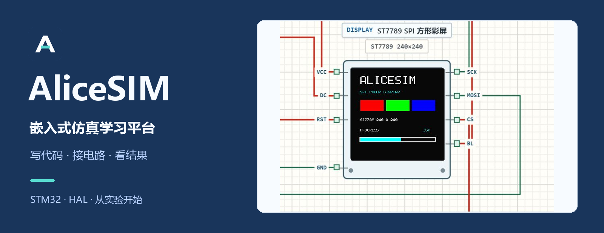
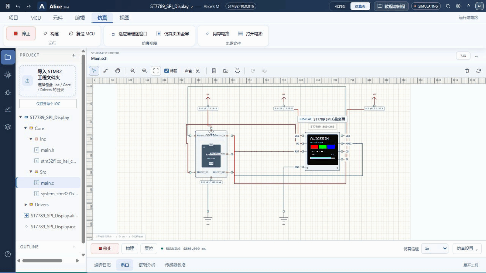
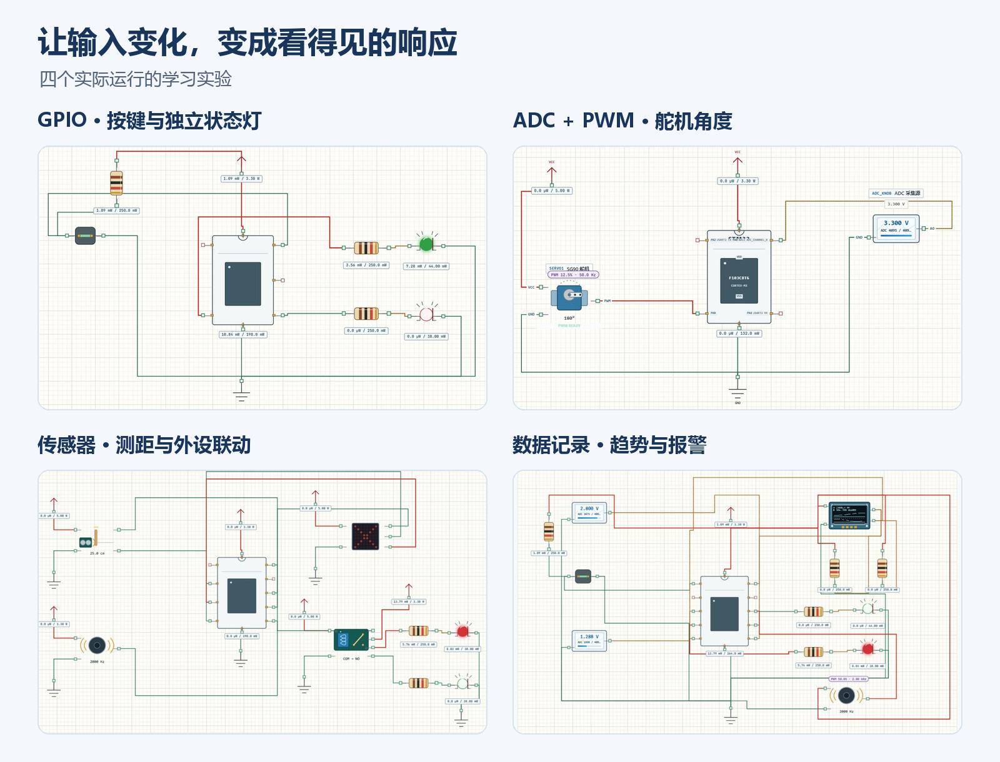
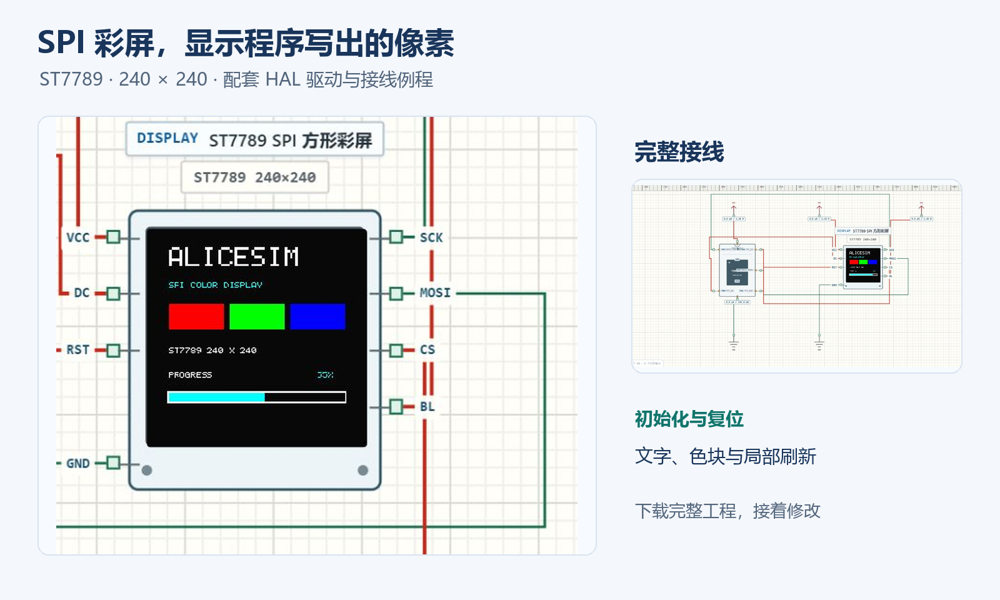
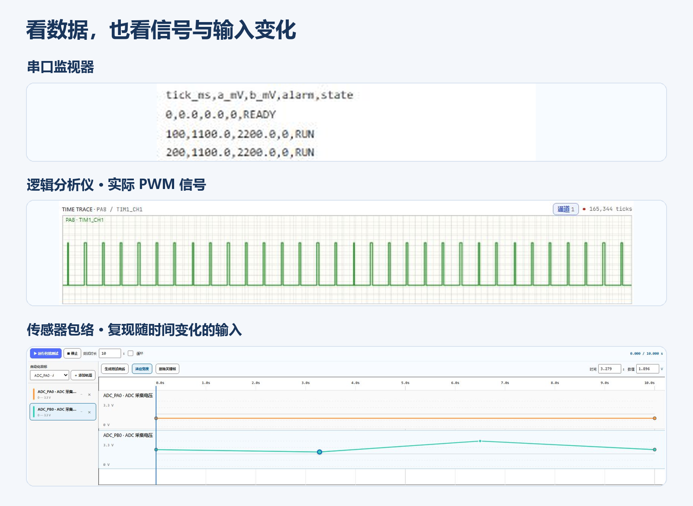
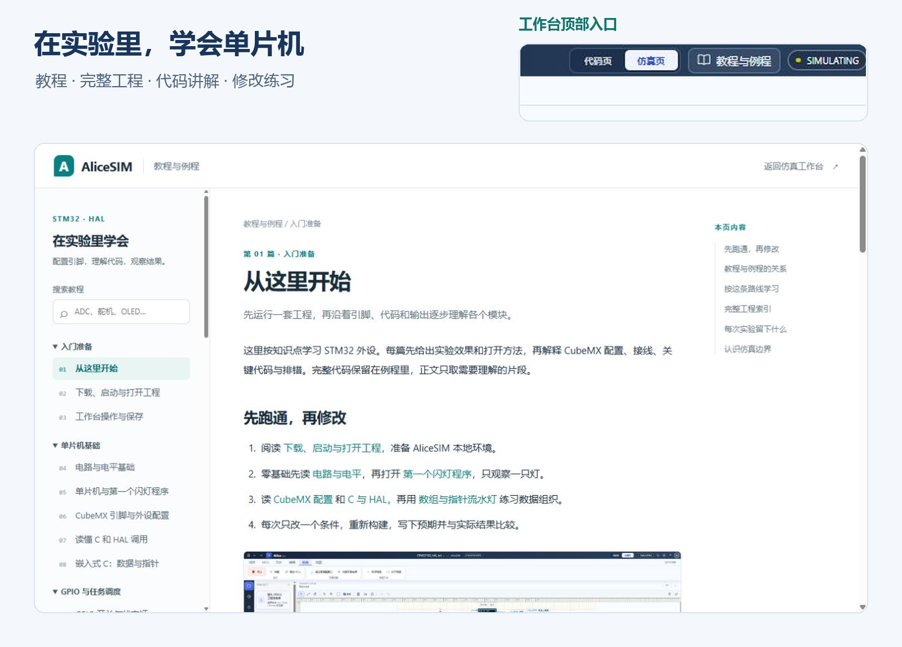

<p align="center">
  <a href="https://github.com/new-bmp/AliceSim/releases/download/v1.0.0/AliceSIM-Launch-2026-1080p.mp4">
    
  </a>
</p>

<p align="center">
  <strong>从第一个闪灯程序，到自己的采集与控制终端。</strong><br />
  在同一工作台里编写 STM32 程序、连接电路、改变输入，观察代码带来的变化。
</p>

<p align="center">
  <a href="https://github.com/new-bmp/AliceSim/releases/tag/v1.0.0">观看宣传片</a> ·
  <a href="https://github.com/new-bmp/AliceSim/archive/refs/heads/main.zip">下载最新源码</a> ·
  <a href="tutorials/README.md">教程与例程</a> ·
  <a href="Drivers/AliceSIM/README.md">外设驱动</a> ·
  <a href="https://github.com/new-bmp/AliceSim/issues">反馈问题</a>
</p>

<p align="center"><sub>STM32F103C8T6 · CubeMX / HAL · 31 篇教程 · 14 套课程工程 + SPI 彩屏例程</sub></p>

## 先看一次实验怎样发生

AliceSIM 是面向学生与教师的嵌入式仿真学习平台。它把工程、代码、电路和观测工具放在一起：导入 CubeMX 工程，核对 IOC 引脚和外设配置，构建固件，再让程序驱动自己连接的元件。

点击顶部封面可打开 **85 秒的 1080p 宣传片**，包含中文旁白、配乐和字幕。[Release 中也提供视频、封面与 SRT 下载](https://github.com/new-bmp/AliceSim/releases/tag/v1.0.0)。以下图片均来自 AliceSIM 实际运行画面。



| 在工作台里 | 可以做什么 |
| --- | --- |
| 工程与代码 | 导入含 `.ioc` 的完整工程，查看引脚配置，编辑 C / C++ 源码，定位构建问题 |
| 电路设计 | 放置元件、端点接线、调整布局，用撤销与重做修改电路，按需要隐藏标签 |
| 固件运行 | 构建、运行、暂停和复位，让已支持的 HAL 调用与电路模型联动 |
| 观察与验证 | 查看串口记录和实际 GPIO 波形，用包络为输入安排随时间变化的数值 |
| 保存与继续 | 保存代码、IOC、电路和工作区，重新打开完整工程继续实验 |

## 元件会怎样回应程序

用开关改变红绿灯状态，用输入电压控制舵机角度，让距离触发点阵、蜂鸣器和继电器；也可以把双路 ADC 组成带滤波、历史曲线与回差报警的数据记录终端。



元件库覆盖基础电路、输入与传感器、显示与执行器、通信与扩展。配套驱动包含 SSD1306、ST7789、TM1637、MAX7219、SG90、DHT11、HC-SR04、MPU6050、DS3231、W25Qxx 等，可从“项目 → 添加 AliceSIM 驱动”加入工程。[查看驱动接口与接线说明 →](Drivers/AliceSIM/README.md)

### 新增 ST7789 SPI 彩屏

240 × 240 彩屏显示文字、RGB 色块和动态进度条。程序通过普通 HAL GPIO 与 SPI 调用发送命令、地址窗口和像素，屏幕根据接线与实际传输数据更新；例程使用局部刷新，配有驱动、源码、IOC 和完整电路。



[阅读彩屏说明](examples/ST7789_SPI_Display/README.md) · [下载完整工程 JSON](https://github.com/new-bmp/AliceSim/raw/refs/heads/main/examples/ST7789_SPI_Display/ST7789_SPI_Display.alice.json) · [查看驱动](Drivers/AliceSIM/Inc/alicesim_st7789.h)

## 让调试过程看得见

串口查看测量记录和接收命令，逻辑分析仪观察 GPIO / PWM 信号，传感器包络按统一时间轴改变输入。构建与运行日志在电路页也能查看，排错时可以对照程序、连线与输出。



固件运行在 Web Worker；波形按显示需要抽样、压缩，并用 WASM 内核辅助波形变化检测与批量传感器数值处理。运行中遇到不支持的行为会明确停止并报告，便于区分代码问题、模型边界和电路问题。

## 从入门到综合实验

启动软件后，点击顶部 **“教程与例程”**；小屏幕显示为“教程”，帮助中心也保留入口。教程页可直接下载完整工程 JSON 和源码 ZIP，内容包括 CubeMX 配置、接线、代码解释、运行现象与练习。



| 学习阶段 | 内容 | 从这里开始 |
| --- | --- | --- |
| 第一次接触单片机 | 电路与电平、CubeMX 配置、最小闪灯、C 数据与指针 | [第一个闪灯程序](tutorials/lessons/mcu-first.md) |
| 输入与任务调度 | GPIO、非阻塞计时、消抖、长按、EXTI 与定时器中断 | [开关与状态灯](tutorials/lessons/gpio.md) |
| 外设与总线 | ADC、PWM、UART 收发、I²C、SPI、显示与传感器 | [ADC 与 PWM 舵机](tutorials/lessons/pwm-servo.md) |
| 综合与验证 | ADC 循环 DMA、滤波、趋势记录、报警、排错与实机调试 | [双路采集与趋势记录](tutorials/lessons/logger.md) |

[浏览全部 31 篇教程与 14 套课程工程 →](tutorials/README.md)

## 快速开始

### 1. 下载并启动

Windows 源码运行需要 **64 位 Python 3.10+**，以及 Edge 或 Chrome。[下载当前主分支源码 ZIP](https://github.com/new-bmp/AliceSim/archive/refs/heads/main.zip)，完整解压后双击根目录 **`AliceSIM.cmd`**。

首次启动会在项目 `.vendor` 目录准备 Clang 18 和相关依赖，需要网络。启动器从 `4173` 开始选择空闲端口，等待服务就绪后打开无边框全屏窗口；以启动窗口显示的地址为准。关闭服务时，在该窗口按 `Ctrl+C`。

C++ 工程另需 GNU Arm 的 `arm-none-eabi-g++`，可使用 STM32CubeIDE 附带的工具链，或通过 `ALICESIM_ARM_GXX` 指定该可执行文件；启动器不会自动安装 C++ 工具链。

需要普通浏览器窗口时，在项目目录运行：

```powershell
.\AliceSIM.cmd -Windowed
```

### 2. 打开一套完整例程

打开“教程与例程”，下载第一个闪灯课程的 **完整工程 · JSON**。回到工作台，从 **“项目 → 打开 IOC / 工程包”** 打开文件，构建成功后点击运行。

也可导入 `tutorials/examples/Learning07_Blink` 整个文件夹，或直接打开[彩屏完整工程](examples/ST7789_SPI_Display/ST7789_SPI_Display.alice.json)。自己生成 CubeMX 工程时，应选择同时含 `.ioc`、`Core`、`Drivers` 的根目录；单独 IOC 只包含配置，不包含完整固件。

### 3. 修改、验证并保存

修改代码后重新构建，再观察电路与串口。用 `Ctrl+S` 保存完整项目，用 `Ctrl+Shift+S` 导出可备份、迁移或提交作业的 `.alice.json` 工程包。[详细安装与操作教程 →](tutorials/lessons/setup.md)

## 保存的是哪一部分

| 操作 | 保存内容 |
| --- | --- |
| `Ctrl+S` · 保存项目 | 代码、IOC、电路与工作区；可写工程保存到工程内的 `AliceSIM` 工作目录，否则使用当前浏览器与页面地址的本地存储 |
| `Ctrl+Shift+S` · 导出完整工程 | `.alice.json`，适合备份、换电脑、交作业与分享例程 |
| `Ctrl+Alt+S` · 电路另存为 | `.alice-sch.json`，包含元件、数值、位置、旋转、导线与画布视图 |
| `Ctrl+Alt+O` · 打开电路 | 加载独立电路；完整程序请使用工程包或源码目录 |

<details>
<summary><strong>更多启动选项</strong></summary>

在项目目录的 PowerShell 中运行：

```powershell
.\start.ps1 -Port 4300        # 指定首选端口
.\start.ps1 -NoBrowser        # 只启动服务
.\start.ps1 -Windowed         # 普通浏览器窗口
.\start.ps1 -SkipDependencies # 跳过依赖准备
```

启动器会复用同一项目已经运行的实例。依赖准备不会修改系统 LLVM、Python 包或 SPICE 环境；下载失败时，页面会明确显示当前检查与求解能力。

</details>

<details>
<summary><strong>浏览器、PWA 与原生应用</strong></summary>

浏览器可通过“安装应用”将 AliceSIM 安装为 PWA。连接运行中的 AliceSIM 后端时，可以进行 Clang 检查与 HAL 仿真；静态离线页面用于工程和电路编辑，不缓存编译接口结果。

项目包含 Tauri 2 原生壳层。Windows、macOS 和 Linux 桌面包在构建时封装本地 Python / Clang 服务，窗口不包含浏览器右键手势界面；移动端提供触控布局。Android / iOS 不内置 Python、Clang 或 HAL 后端，固件构建需要桌面版，或从浏览器连接可用的 AliceSIM 后端地址。

</details>

<details>
<summary><strong>开发、检查与桌面打包</strong></summary>

前端开发需要 Node.js 20+ 与 pnpm。桌面开发另需 Rust stable、Python 3.10+，打包 sidecar 使用 PyInstaller：

```powershell
pnpm install
pnpm test
pnpm tutorials:check
pnpm desktop:dev
pnpm desktop:build
```

`desktop:build` 先封装本机架构的服务与页面资源，再由 Tauri 生成桌面包。macOS 与 Linux 应分别在对应系统构建。Android 需要 Android Studio、SDK、NDK 和 Rust targets；iOS 需在安装 Xcode 的 macOS 上构建。

教程维护说明见 [tutorials/README.md](tutorials/README.md)，数据手册转器件草稿接口见 [docs/datasheet-import-api.md](docs/datasheet-import-api.md)。

</details>

## 仿真范围

当前目标器件为 **STM32F103C8T6**。AliceSIM 使用 HAL 语义级仿真：本地 Clang 检查 C，C++ 检查使用 GNU Arm 工具链；语义运行时执行已支持的 C 表达式、控制流、库函数与 HAL / 外设驱动调用，再将结果送入电路网络和设备模型。包含 GPIO、ADC、UART、I²C、SPI、PWM、定时器、中断和 DMA 等已建模行为。

它不是完整的 ARM 指令级仿真器。通过 C / C++ 编译检查不代表所有库代码都能建模运行；不支持的操作会报告错误。电路具有电平、连接、驱动冲突及受支持网络的直流求解，完整模拟器件瞬态 SPICE、总线电气时序和芯片周期精度不在当前覆盖范围；UART 监视器通过固件收发队列传递字节，并非 TX / RX 导线逐位采样。

适合用来学习程序与外设如何配合、验证连接和控制逻辑，再沿着[实机调试教程](tutorials/lessons/hardware.md)完成真实开发板上的核对。

---

<p align="center">
  <strong>AliceSIM · 从看见现象，走向理解原理。</strong><br />
  <a href="tutorials/README.md">开始学习</a> ·
  <a href="https://github.com/new-bmp/AliceSim/releases/tag/v1.0.0">宣传片与发布</a> ·
  <a href="https://github.com/new-bmp/AliceSim/issues">提交反馈</a>
</p>
