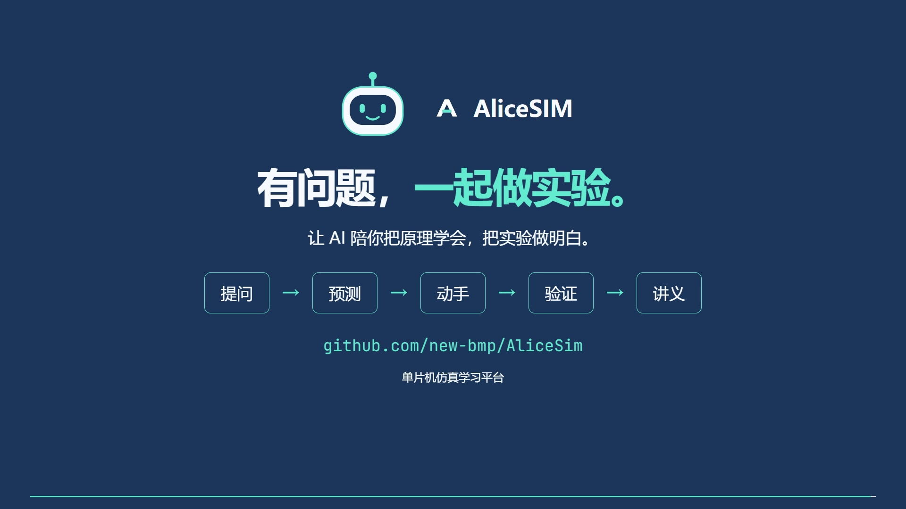

# AliceSIM · 有问题，一起做实验

90 秒，1920 × 1080，30 fps，中文旁白、配乐与同步字幕。

[观看 / 下载 MP4](https://github.com/new-bmp/AliceSim/raw/refs/heads/main/docs/showcase/ai-companion-2026/AliceSIM-AI-Companion-2026-1080p.mp4) · [中文字幕 SRT](subtitles.srt) · [封面](cover.jpg)

| 时间 | 内容 |
| --- | --- |
| 00:00–00:22 | 电压驱动舵机、元件联动、SPI 彩屏、PWM 波形、虚拟串口和输入包络 |
| 00:22–00:36 | AI 理解当前代码、接线、配置和运行记录，直接定位电路与代码 |
| 00:36–00:51 | 预测题、自由回答、分层提示、任务内追问与返回任务 |
| 00:51–01:07 | 双路 ADC DMA 冻结与通道对调排查，两组输入自动验收 |
| 01:07–01:22 | 现场生成讲义、导出、挑战练习、保存进度与自选模型 |
| 01:22–01:30 | 提问、预测、动手、验证、讲义的学习过程 |

软件画面来自 AliceSIM 实际运行。元件联动采用正常速度录屏；AI 互动使用真实模型回复与界面截图剪辑，省略等待过程。DMA 案例复用了已验证的故障与验收记录，代码由人根据提示修改，自动验收来自本机仿真。

视频和音轨均为 90 秒，完整解码检查通过，未检测到异常黑帧。讲义保留 AI 草稿标识，供学习者结合实验复核。
