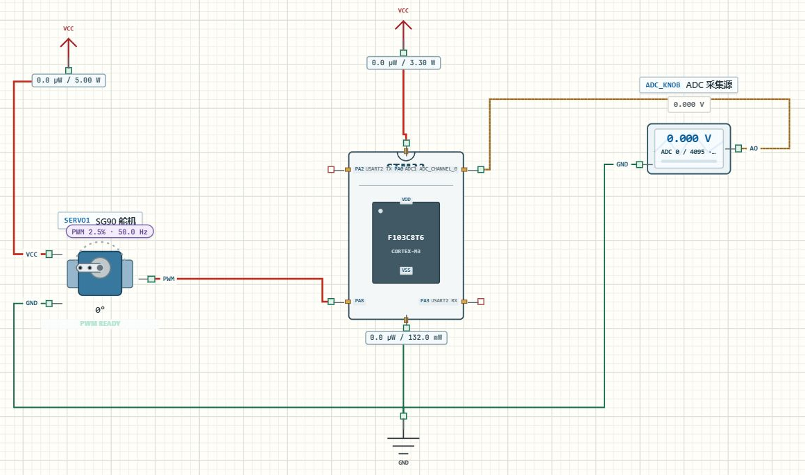

# ADC 单次采样

## 实验效果

调节模拟源电压，ADC 读数改变，程序再将结果转换成角度和脉宽，串口与舵机一起显示结果。本页和 PWM 舵机教程共享 `Learning02_Servo` 综合工程：这里重点看输入采样，舵机只是帮助观察结果的输出。



[下载完整工程](../projects/Learning02_Servo.alice.json) · [阅读 main.c](../examples/Learning02_Servo/Core/Src/main.c)

## 如何使用

1. 在 AliceSIM 的“项目 → 打开 IOC / 工程包”中打开下载的工程，构建成功后运行。
2. 在电路页双击 `ADC_KNOB`，将属性中的电压依次改为 0 V、1.650 V、3.3 V并应用。
3. 展开“串口”，选择 USART2。确认面板显示 115200 baud、8N1，观察角度和脉宽记录。采样约每 100 ms 更新，参数修改后等待下一轮。
4. 若希望直接看原始码，在程序页 `main.c` 的串口格式中加入 `adc_raw`，保存后重新构建。

## 工程配置

| 模块 | CubeMX 配置与接线 |
| --- | --- |
| ADC1 | IN0 对应 PA0，模拟模式，12 位右对齐 |
| 转换 | 软件触发、单通道、单次；关闭连续与扫描 |
| 采样时间 | 55.5 Cycles，常规序列 Rank 1 |
| ADC 时钟 | 72 MHz APB2 ÷6，得到 12 MHz |
| 输入 | ADC_KNOB AO 接 PA0，GND 接公共地，范围 0～3.3 V |

工程在采样前调用 `HAL_ADCEx_Calibration_Start` 校准。真实板卡的模拟参考电压、供电噪声和源阻抗会影响结果；此例用于理解输入、量化和程序处理的关系。

输入源与 MCU 必须共地。AO 要接信号端，不能把源的接地端误接到 PA0；图中两条线相交也不一定相连，应核对端点。

## 关键代码解释

下面摘出启动、等待、取值和停止的顺序。完整工程在得到新值后还计算并发送控制结果。

```c
if (HAL_ADC_Start(&hadc1) == HAL_OK)
{
  if (HAL_ADC_PollForConversion(&hadc1, 10U) == HAL_OK)
  {
    adc_raw = HAL_ADC_GetValue(&hadc1);
  }
  HAL_ADC_Stop(&hadc1);
}
```

`Start` 返回操作状态，`GetValue` 才返回采样数值。只有启动、等待都成功，才使用新样本；等待参数 10U 是毫秒超时。若失败，需要单独记录失败状态，不能把上轮变量当作新测量。

12 位 ADC 有 4096 个编码，编号 0～4095。工程按端点映射，近似毫伏值为 `raw×3300÷4095`。计算时先把乘法提升到足够宽的类型，不能在 16 位变量中存乘积。

```c
angle_x10 = (adc_raw * 1800U + 2047U) / 4095U;
```

这是工程实际的角度映射：角度乘十保存，900 代表 90.0°；2047 用于整数取整。一个量化台阶约为 0.806 mV，屏显小数并不增加 ADC 的物理分辨率。

## 预期输入输出

| 电压 | 原始码大致范围 | 串口结果 |
| --- | --- | --- |
| 0 V | 0 | ANGLE=0.0，PULSE=500 |
| 1.650 V | 2047 或 2048 附近 | 约 90°、1500 μs |
| 3.3 V | 4095 | ANGLE=180.0，PULSE=2500 |

## 故障排查

**电压改了，值不变**：查 AO 是否接到 PA0、通道是否为 ADC1_IN0、是否已应用属性，再查运行日志。

**小幅变化看不出来**：先比较原始整数码。输入变化小于量化台阶或显示舍入范围时，结果可能相同。

## 练习

1. 取五个输入电压，手算原始码近似值，再与串口对照。
2. 在串口加入整数 mV，保留原始码帮助判断舍入误差。
3. 给模拟源添加阶跃包络，比较 100 ms 与 500 ms 更新周期。
