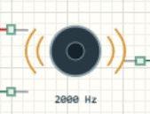

# PWM 蜂鸣器与音调参数

## 先看 PWM 状态

无源蜂鸣器需要周期信号，频率决定音调，启停和节奏表达状态。本文使用 [Learning06_Components 完整工程](../projects/Learning06_Components.alice.json)，与超声波、点阵、继电器共享项目，不是独立发声例程。

当前 AliceSIM 提供蜂鸣器启停、频率与 PWM可视状态，不会通过电脑扬声器播放对应声音。请用状态标记和逻辑分析仪验证；没有声音不是这个例程运行失败。



## 打开并切换输入

打开工程包，构建运行，修改 HC-SR04目标距离并应用。150 cm时蜂鸣器为 STOP，75 cm时应为 1 kHz、50%占空比，25 cm时为 2 kHz、50%。在逻辑分析仪选择 PA0，必要时缩小时间尺度，分别观察约 1 ms和 0.5 ms的周期。

## 接线与 CubeMX

| 项目 | 本工程设置 |
| --- | --- |
| SIG | PA0，TIM2_CH1 |
| 供电 | 带 VCC/GND/SIG的 PWM模块，3.3 V，共地 |
| TIM2 | PWM Generation CH1，PWM mode 1，高有效 |
| 时钟 | HSI 8 MHz，TIM2时钟 8 MHz |
| 初值 | Prescaler=7，Period=499，Pulse=0 |

本例使用带接口的模块。裸蜂鸣器、不同电压模块或较大电流负载，应按其规格增加合适驱动，不能默认都由 GPIO直接供能。不要把有源蜂鸣器的固定音调特性套到无源 PWM模块。

## 频率怎样换成周期

[main.c](../examples/Learning06_Components/Core/Src/main.c) 把驱动绑定到 TIM2_CH1，并告知计数时钟为 1 MHz。

```c
AliceSIM_Buzzer_Init(&buzzer, &htim2,
                    TIM_CHANNEL_1, 1000000U);
```

预分频寄存器填 7实际除以 8，因此 8 MHz变为 1 MHz。1 kHz需要每周期 1000次计数，对应 ARR=999、CCR约 500；2 kHz需要 500次，对应 ARR=499、CCR约 250。驱动运行时修改 ARR和 CCR，不只使用 CubeMX初值。

下面摘出注意区的一句调用。第三个参数是占空比千分数，500表示 50%，不是 500 Hz。

```c
AliceSIM_Buzzer_Set(&buzzer, 1000U, 500U);
```

停止区改为 2000 Hz，安全区调用 `AliceSIM_Buzzer_Stop(&buzzer)`。Set会在需要时启动 PWM；Stop会停止 PWM并清比较值。改变 ARR也影响同一定时器的其他通道，不能给需要不同周期的负载随意共用 TIM2。

## 测试与排错

按 150→75→25→150 cm测试，预期 STOP→1 kHz→2 kHz→STOP，最后必须停止，不能只验证启动。传感器故障也会使用 2 kHz报警。

状态不工作先查 VCC、GND、SIG与 TIM2_CH1。频率成倍不对，核对定时器实际时钟和预分频的加一关系。若只是无电脑音频，回到本页开头的模型说明，用 PA0波形和模块频率判断结果。

## 修改练习

把注意音调改为 1500 Hz并计算 ARR；将占空比改为 250，检查高电平占比；加入“距离越近，提示间隔越短”的节奏，用 tick控制启停，避免长延时阻塞测距。先写清频率与节奏各控制什么。
