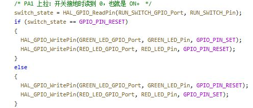

# 读懂 C 和 HAL 调用

## 实验效果

本页帮助你读懂教程代码，再做一次可验证的修改：知道参数代表什么、返回值是不是测量值、结果怎样通过指针交回、整数计算有没有溢出。它是通用入门页，可先使用 [GPIO 工程](../projects/Learning01_GPIO.alice.json) 和 [main.c](../examples/Learning01_GPIO/Core/Src/main.c) 练习。



## 如何使用

打开工程后，在程序页找到 `Core/Src/main.c`，先读 `main` 的初始化顺序，再读 `while (1)`。只修改一个条件或参数，保存后重新构建运行；旧构建结果不能证明新代码工作。

构建包含语法检查、HAL 建模与引脚绑定。某个库能通过 C 语法检查，不表示它的所有硬件行为都已建模。遇到诊断要保留函数名、文件行号和第一条错误。

## 工程配置

| 内容 | 应到哪里核对 |
| --- | --- |
| 芯片、引脚、时钟 | IOC 与 `SystemClock_Config` |
| 引脚名称 | `Core/Inc/main.h` 的宏 |
| 外设模式与句柄 | `MX_GPIO_Init`、`MX_USART2_UART_Init` 等 |
| 驱动函数参数 | 对应头文件中的声明 |

GPIO 工程使用 HSE 8 MHz、PLL ×9，PA1 为上拉输入，PB12/PB13 为两路输出，USART2 为 115200 8N1。命名方便阅读，接线仍要落到实际端子。

## 关键代码解释

HAL 句柄保存外设实例和配置，`&hadc1` 表示把它的地址交给函数。下面的结构摘自 [ADC 舵机工程](../examples/Learning02_Servo/Core/Src/main.c)，省略了成功读值后的计算与输出。

```c
if (HAL_ADC_Start(&hadc1) == HAL_OK)
{
  if (HAL_ADC_PollForConversion(&hadc1, 10U) == HAL_OK)
  {
    adc_raw = HAL_ADC_GetValue(&hadc1);
  }
  HAL_ADC_Stop(&hadc1);
}
```

`Start` 返回操作状态，`GetValue` 返回数值，不能混用。`if/else` 选择分支，`for` 遍历数组，`while` 重复执行；`break` 退出最近的循环或 switch，`continue` 跳过本轮余下语句，`return` 结束当前函数。

[记录仪源码](../examples/Learning05_Logger/Core/Src/main.c) 的 `ReadPair(&a, &b)` 传入两个变量的地址，函数内用 `*a`、`*b` 写回结果，并用返回值表示两路是否都成功。地址必须有效；长度为 32 的数组合法下标只有 0～31。

数字后的 U、UL 分别表示无符号整数、无符号 long，不是单位。单位取决于 API 或变量约定。记录仪下面的实际换算，必须在乘法前使用 64 位中间量。

```c
mv10_a = (uint32_t)(
  ((uint64_t)sum_a * 33000U + filter_count * 2047U)
  / (filter_count * 4095U));
```

`mv10_a` 保存 0.1 mV，除十得整数部分、余十得一位小数。32 点满量程之和乘 33000 超过 32 位上限，先算溢出后再强转无法修复。

## 预期输入输出

在 GPIO 工程把 ON 条件改为判断高电平，重新构建后开关含义会反转；恢复条件即可恢复原行为。这说明画面由执行的分支决定。再把 20 ms延时改为 500 ms，应观察到更慢的轮询响应，而非 MCU 时钟变慢。

## 故障排查

**变量有旧数值但外设失败**：检查状态判断，不要把“变量非零”当作操作成功。

**满量程才出现异常**：核对乘法中间类型、数组边界和格式符。字符串发送长度还要小于缓冲容量。

## 练习

1. 解释为什么读取 GPIO 时用 `==`，给变量赋值时用 `=`。
2. 在纸上走一遍循环与分支，标出 return、break 的作用范围。
3. 找到一处 tick 差调度，与 `HAL_Delay` 比较，说明阻塞通信仍会影响实际任务间隔。
