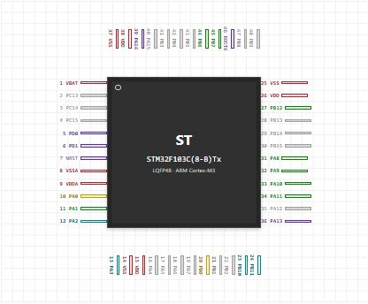
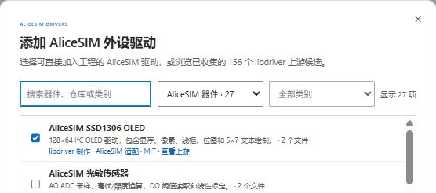

# CubeMX 引脚与外设配置

## 创建与 GPIO 例程对应的工程

本页以 Learning01_GPIO 为起点。配套源码为了便于阅读，把部分初始化集中在 `main.c`；你用 CubeMX 选择分文件生成后，也可能在 `gpio.c`、`usart.c` 中找到它们。文件位置可以不同，引脚与外设设置必须对应。

1. 在 STM32CubeMX 新建 MCU 工程，搜索 `STM32F103C8T6`，确认型号与封装。
2. 把 PA1 设为 GPIO_Input、Pull-up；PB12、PB13 设为 GPIO_Output、推挽。PB12 初始 Low，PB13 初始 High。
3. 启用 USART2 Asynchronous，PA2 为 TX、PA3 为 RX，配置 115200、8 位、无校验、1 位停止位。
4. 在 RCC 启用 HSE Crystal/Ceramic Resonator。时钟页设置 HSE 8 MHz、PLL ×9、SYSCLK 72 MHz、AHB 不分频、APB1 二分频、APB2 不分频。
5. Project Manager 设置名称、目录与使用的工具链；可选择为每个外设生成独立 `.c/.h` 文件。
6. 生成后保留 `.ioc`、Core 和 Drivers，把业务代码放在 USER CODE 区域。重新生成前备份修改。

上图是 AliceSIM 对 IOC 的核对页面，实际引脚设置在 CubeMX 完成。导入整个生成目录后，再补上电路和业务代码。只把 GPIO 命名为 GREEN_LED 不会自动连上 LED。

## 配置、代码与电路要一起改

PA1 的开关闭合接地，因此低电平表示运行；外部 10 kΩ 上拉仍保留。PB12 经 330 Ω 控制绿灯，PB13 独立控制红灯，LED 阴极接地。把灯迁移到另一个 GPIO 时，同步改宏、初始化和导线。

IOC 帮助核对配置，但固件实际执行的是生成的初始化函数。改了 IOC 后要重新生成或同步代码，不能指望一份旧的 `MX_ADCx_Init()` 自动跟着改变。

## 为模块启用所需外设

| 模块 | CubeMX 要检查 | 电路与驱动要检查 |
| --- | --- | --- |
| ADC | 模拟引脚、通道、采样时间、触发 | 信号端与对应通道，0～3.3 V 量程 |
| 舵机 PWM | TIM 通道、PSC、ARR、Pulse | 引脚复用、周期与脉宽范围 |
| OLED | I2C1、PB6/PB7、速率 | 共地、上拉、7 位地址约定 |
| MAX7219 | SPI1 主机、8 位、Mode 0、软件 NSS | SCK/MOSI 与独立 CS 引脚 |
| DHT11 / TM1637 | GPIO 模式与上下拉 | 开漏与上拉，TM1637 不是 I²C |
| ADC DMA | 请求、循环、半字宽度、NVIC | DMA 链接、缓冲区、两个回调 |

GPIO、舵机与记录仪例程使用 72 MHz；温湿度、DMA 与元件联动例程使用 HSI 8 MHz。定时器参数不能跨工程照抄。APB 分频不为 1 时，F1 定时器时钟还有倍频规则，计算 PWM 前先查对应时钟树。

## 添加模块驱动

工作台“项目 → 添加 AliceSIM 驱动”可以添加所需器件。学习工程已经带齐驱动，不必重复覆盖。头文件描述类型与接口，源文件实现协议与数据处理，常见目录为 `Drivers/AliceSIM/Inc` 与 `Src`。

调用前读函数声明，分清外设句柄地址、GPIO 端口与数值。例如本 SSD1306 驱动接受 `0x3C` 的 7 位地址，内部再左移传给 HAL；不能直接套用别的驱动中的 `0x78`。

## 完成检查

先在 IOC 报告核对引脚和时钟，再读生成的初始化，最后检查电路。构建后用固定输入测一次，再进入各模块教程做边界实验。更换引脚后没有效果，优先查这三处是否一致，而不是继续修改显示文字。
