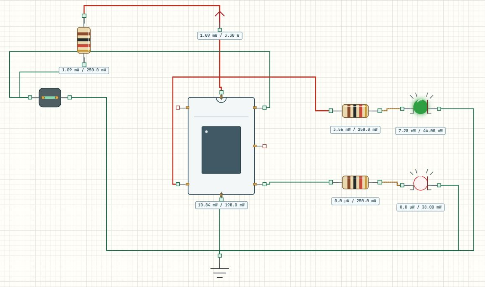

# GPIO 开关与状态灯

## 实验效果

拨动开关，绿灯和红灯互相切换；串口只在状态改变时报告一次。两只灯由 PB12、PB13 分别控制，可以独立亮灭。



本页使用 [Learning01_GPIO 完整工程](../projects/Learning01_GPIO.alice.json)，关键逻辑在 [main.c](../examples/Learning01_GPIO/Core/Src/main.c)。

## 如何使用

1. 下载完整工程，在 AliceSIM 的“项目 → 打开 IOC / 工程包”中打开。也可导入教程目录下的整个 `examples/Learning01_GPIO` 文件夹。
2. 电路页点击“构建”，成功后点击“运行”。初始开关 OFF，应红灯亮、绿灯灭。
3. 在鼠标选择模式下双击 `SW_RUN` 切换状态，观察两只灯。
4. 展开底部“串口”，选择 USART2，确认显示 115200 baud、8N1；这些参数来自程序配置，不需在面板另设。

## 工程配置

| 对象 | CubeMX 设置与接线 |
| --- | --- |
| PA1 | GPIO Input、Pull-up；经 10 kΩ 上拉，开关闭合接地 |
| PB12 | 推挽输出，初始 Low；经 330 Ω 接绿 LED 阳极 |
| PB13 | 推挽输出，初始 High；经 330 Ω 接红 LED 阳极 |
| USART2 | PA2 TX、PA3 RX，115200、8 位、无校验、1 位停止位 |
| 时钟电源 | HSE 8 MHz、PLL ×9、72 MHz；MCU 3.3 V，所有地相连 |

LED 阴极接地。PA1 断开时被上拉为高电平，闭合时为低电平，所以“开关 ON”对应数值 0。这叫低有效，与开关图形的文字无关。

初始化先使能 GPIOA、GPIOB 时钟，再设置输出初始值和模式，最后配置输入。给灯换一个引脚时，要同步修改宏、初始化和导线。仅改灯的标签或程序中的一条写语句，不能完成引脚迁移；真实 LED 还要按压降和电流选择限流电阻。

## 关键代码解释

下面是主循环的 ON 分支，宏名称在 `main.h` 中绑定到实际引脚。

```c
switch_state = HAL_GPIO_ReadPin(
  RUN_SWITCH_GPIO_Port, RUN_SWITCH_Pin);
if (switch_state == GPIO_PIN_RESET)
{
  HAL_GPIO_WritePin(GREEN_LED_GPIO_Port,
    GREEN_LED_Pin, GPIO_PIN_SET);
  HAL_GPIO_WritePin(RED_LED_GPIO_Port,
    RED_LED_Pin, GPIO_PIN_RESET);
}
```

读取函数给出输入电平，两次写函数分别控制两个输出。完整代码的 `else` 把两个输出反转。主循环末尾等待 20 ms，再读取下一次输入。它是轮询，等待期间主循环不能处理别的语句；模型没有机械触点抖动，实物按键仍需消抖。

串口部分比较当前值与 `previous_switch_state`，发送后更新历史值，因此保持开关不动不会重复刷屏。初始历史值为 2，启动时也会报告初始状态。

## 预期输入输出

| 操作 | PA1 | 绿灯 | 红灯 | 串口 |
| --- | --- | --- | --- | --- |
| OFF | 高 | 灭 | 亮 | SW=OFF |
| ON | 低 | 亮 | 灭 | SW=ON |
| 保持不动 | 不变 | 不变 | 不变 | 不重复发送 |

## 故障排查

**状态相反**：核对开关闭合是否接地，条件是否判断 `GPIO_PIN_RESET`。不要只对调灯的颜色。

**串口正确但灯不亮**：先查 PB12/PB13 是否接对、LED 极性与公共地，再查 GPIO 输出配置。程序运行日志中的错误也要一并查看。

## 练习

1. 在程序页将 ON 分支改为两灯同时亮，重新构建，证明两个输出独立。
2. 把延时改成 500 ms，比较切换响应，再恢复 20 ms。
3. 为 OFF 状态增加红灯闪烁，尝试用 tick 计时保持开关响应。
