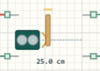

# HC-SR04 超声波测距

## 距离怎样进入程序

HC-SR04 用 TRIG接收触发信号，用 ECHO脉宽表示声波往返时间。本文使用 [Learning06_Components 完整工程](../projects/Learning06_Components.alice.json)，与点阵、蜂鸣器、继电器共享泊车提示台，不是独立的纯测距例程。



## 打开运行

打开完整工程，构建并运行。在虚拟串口选择 USART2，核对 115200、8N1。双击 HC-SR04，把“目标距离”设为 150 cm并应用，应看到 `DIST=150.0 cm ZONE=SAFE RELAY=OFF`。再设 75与 25 cm，程序应分别进入 CAUTION与 STOP，联动点阵和负载。

## 接线与 CubeMX

| 引脚 | 本工程设置 |
| --- | --- |
| TRIG → PB1 | GPIO推挽输出，初始低 |
| ECHO → PB10 | GPIO输入，无上下拉 |
| VCC / GND | 5 V / 公共地 |
| 微秒计时 | HSI 8 MHz，DWT计数辅助 |
| 串口 | USART2 PA2 / PA3，115200、8N1 |

ECHO是 5 V模块输出。PB10是 STM32F103C8T6的 FT数字输入，但仍须满足该芯片手册的供电及数字输入条件；不能据此把任意 ADC脚或其他 MCU的 GPIO直接接 5 V。实物可选适当分压或电平转换，并核对上电顺序。

## 驱动返回状态和距离

[main.c](../examples/Learning06_Components/Core/Src/main.c) 将设备对象与两根线、延时和时钟函数绑定，30 ms为超时限制。

```c
AliceSIM_HCSR04_Init(&ranger, GPIOB, GPIO_PIN_1,
    GPIOB, GPIO_PIN_10, Timing_DelayUs,
    Timing_Micros, 30000U);
measure_status = AliceSIM_HCSR04_MeasureMm(
    &ranger, &distance_mm);
```

驱动先拉低 TRIG约 2 µs，再拉高约 10 µs，等待并测量 ECHO高电平。按声速 343 m/s换算，距离等于脉宽乘声速再除二，结果以毫米整数保存。500表示 50 cm，不是 500 cm。

例如目标约 100 cm时，理想往返时间约 5.83 ms。除以二是因为测得的是发出到返回的总路程；若忘记这一点，计算距离会接近真实距离的两倍。ECHO脉宽表示时间，不是模拟电压大小。

```c
if (measure_status != ALICESIM_HCSR04_OK) zone = 3U;
else if (distance_mm < 500U) zone = 2U;
else if (distance_mm < 1000U) zone = 1U;
else zone = 0U;
```

先判断状态，再使用距离。失败时执行故障报警，不继续显示旧的安全距离。驱动范围检查为 20～4000 mm；工程每轮末尾等待 100 ms，加上测量和传输时间，触发间隔大于常用的 60 ms要求。

## 边界测试与排错

依次测试 100.0、50.0、49.9 cm，预期分别为 SAFE、CAUTION、STOP。停止并另存副本，断开传感器电源再构建运行，应输出 `SENSOR ERROR` 并报警，不报告安全。恢复连接后重新运行，应能回到正常区域。

总是超时，先检查共地、VCC、TRIG/ECHO有无接反，再核对绑定端口。总差十倍先检查 mm与 cm换算，不要急着改声速常量。仿真目标距离是可控测试输入；实物还受目标材质、角度、盲区和环境温度影响。

## 修改练习

把停止线改为 30 cm并测试 29.9 / 30.0 / 30.1；增加连续三次成功才解除故障的规则；在 50 cm附近加入 2 cm回差。先列出边界预期，再改代码验证。
