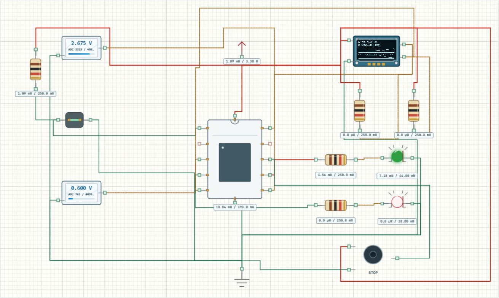

# 双路采集与趋势记录

## 实验效果

让两路电压依次完成采样、滤波、历史记录和报警，再用 OLED 与 CSV 核对同一份结果。这次重点是把模块组织成系统：开关决定是否采集，ADC 提供新样本，滤波值同时影响图形、串口和报警，不能各自维护互不相干的数值。



[下载 Learning05_Logger 完整工程](../projects/Learning05_Logger.alice.json) · [阅读 main.c](../examples/Learning05_Logger/Core/Src/main.c)

## 如何使用

1. 在 AliceSIM 打开完整工程，构建、运行。项目包带 8 秒循环输入包络；源码目录导入则使用 A=1.1 V、B=2.2 V 静态输入。
2. 手动测试前，在“仿真设置”的时间流选择“无限运行”。若需要复位，先复位，再双击模拟源设置电压，因为当前复位仍会写一次包络首点。
3. 开关默认闭合。展开串口选择 USART2，确认显示 115200 baud、8N1，观察时间、电压、报警和状态五列。
4. 在选择模式下双击开关切到 OFF，应显示 READY；再次闭合应建立新记录。

## 工程配置

| 模块 | 配置和接线 |
| --- | --- |
| 两路 ADC | ADC1_IN0→PA0，ADC2_IN8→PB0，单次软件触发 |
| 运行开关 | PA1 上拉输入，闭合接地 |
| 状态灯 | PB12 绿灯、PB13 红灯，独立 GPIO 和限流电阻 |
| OLED | I²C1 PB6/PB7，400 kHz、0x3C、外接上拉 |
| 蜂鸣器 | TIM1_CH1 PA8，2 kHz、50% 占空比 |
| 时钟串口 | HSE 8 MHz、PLL ×9；USART2 115200 8N1 |

两路依次读取，不是严格同时采样。`ReadPair` 只有两路都成功才返回成功，随后 `AddSample` 更新滤波；读取失败则显示错误并报警。

## 关键代码解释

每路保存最近 32 个原始值，用累加和减旧加新。启动时按有效数量除，窗口未满不能固定除以 32，否则初始读数会被零拉低。

```c
mv10_a = (uint32_t)(
  ((uint64_t)sum_a * 33000U + filter_count * 2047U)
  / (filter_count * 4095U));
```

结果单位为 0.1 mV。满窗口乘积会超出 32 位上限，所以先用 `uint64_t` 再乘。报警使用滤波值：任一路达到 2500 mV 触发，只有两路都不高于 2300 mV 才解除，处于两阈值之间保持原状态。

滤波缓存与历史缓存各有 32 点，职责不同。前者标称每 20 ms 更新，后者标称每 100 ms 写入一次显示值，首末名义跨度约 3.1 秒。阻塞 I²C、UART 会延长间隔，应看 CSV 时间戳；仿真也不是指令周期测量。蜂鸣器显示活动状态和 PWM，不会让电脑扬声器出声。

## 预期输入输出

| 操作 | 等滤波稳定后的预期 |
| --- | --- |
| A=1.1 V、B=2.2 V | 绿灯、RUN，约 1100/2200 mV |
| A→3.1 V | 滤波渐升，红灯、ALARM |
| A→2.4 V | 报警保持 |
| A→2.2 V | 两路低于下限，解除报警 |
| B→3.0 V | B 路也可单独触发 |
| 开关 OFF→ON | READY 后清零有效计数，重建历史 |

## 故障排查

**改完电压仍在变化**：确认已切无限运行；刚改变输入时，32 点窗口也需要逐步替换旧值。

**CSV 变了，曲线没动**：图形纵向像素有限，小变化可能不足一个像素。先比较电压列，不要据此认定 ADC 没工作。

## 练习

1. 将滤波点数改为 8，重复阶跃测试，比较响应速度。
2. 将显示周期改为 200 ms，预测 32 点首末跨度，再检查时间戳。
3. 暂停后复制串口文本，删除界面时间、`USART2 TX → HOST:` 前缀和其他提示，保留表头及数据，存为 UTF-8 CSV 并绘图。当前没有 CSV 下载按钮；READY、ADC_ERROR 保留为状态，勿当作新测量连线。
