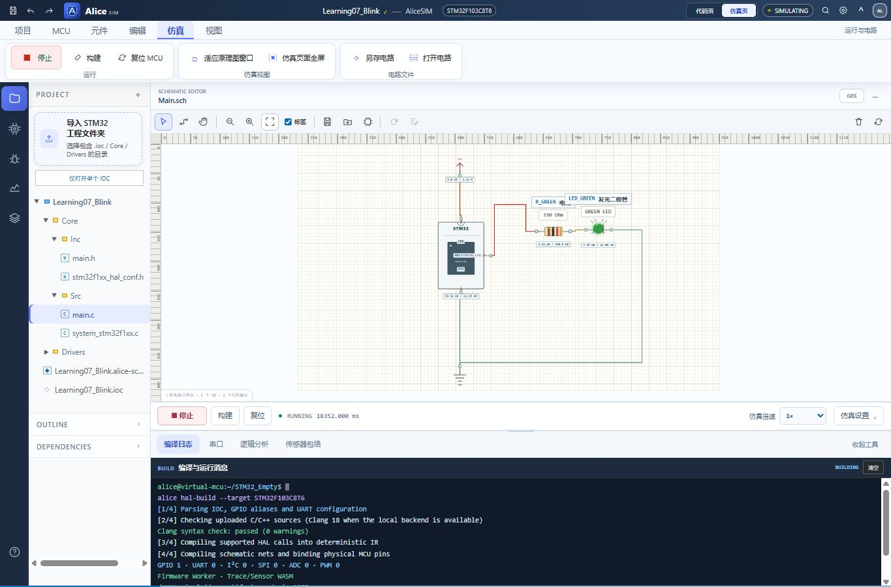

# 单片机与第一个闪灯程序

## 一颗芯片里有哪些部分

单片机把 CPU、存储器和外设集成在同一芯片中。CPU 依次执行指令；Flash 保存断电后仍保留的固件；RAM 保存运行中的变量、栈和缓冲区，断电后通常丢失。GPIO、定时器、ADC、串口等外设让程序与外部世界交换信息。

本课的 STM32F103C8T6 使用 Cortex-M3 CPU，标称 64 KB Flash、20 KB SRAM。8 MHz 表示时钟每秒约八百万次变化周期，不表示每行 C 代码正好用一个周期，也不能直接用源代码行数估计执行时间。

用 [Learning07_Blink 完整工程](../projects/Learning07_Blink.alice.json) 先运行一颗 LED，再把看到的现象对应到 [main.c](../examples/Learning07_Blink/Core/Src/main.c)。本例使用芯片内部 HSI 8 MHz，不要求外接晶振。



上图是本例在 AliceSIM 中的运行画面。绿灯会交替亮灭；底部编译日志可确认构建结果，逻辑分析仪可观察 PB12 的电平变化。

## 从复位到 main

上电或复位后，芯片按启动配置选择启动位置。正常从用户 Flash 启动时，CPU 从向量表取得栈指针和复位入口，执行启动代码，完成系统与 C 运行环境准备，例如设置初始数据、清零应清零的变量区域，然后进入 main。

main 前还有启动过程，所以“程序从 main 开始”是学习业务逻辑时的简化说法。BOOT 引脚、启动文件、链接脚本或供电出问题，都可能导致业务代码无法运行。真正下载和调试时再按 [实机教程](hardware.md) 核对这些内容。

本例 main 中首先执行：

```c
HAL_Init();
SystemClock_Config();
MX_GPIO_Init();
```

HAL_Init 初始化 HAL 和默认毫秒时间基准。SystemClock_Config 选择 HSI、关闭 PLL，使 CPU 和总线使用 8 MHz。MX_GPIO_Init 先开启 GPIOB 外设时钟，再设初始低电平和 PB12 的输出模式。给 GPIO 外设打开时钟与给整颗芯片上电是不同操作。

## while 循环为什么能持续闪灯

```c
while (1)
{
  HAL_GPIO_TogglePin(GREEN_LED_GPIO_Port, GREEN_LED_Pin);
  HAL_Delay(500U);
}
```

while (1) 表示反复执行括号中的语句。TogglePin 把原有低电平变高，或把原有高电平变低。PB12 初始为低，第一次循环将它写高，LED 点亮。等待名义 500 ms 后继续循环，第二次将它变低。

500U 中的 U 表示无符号整数常量，500 的时间单位来自 HAL_Delay 接口约定。一次完整亮灭包含两次等待，周期约 1 s；实物延时还受 SysTick 粒度和函数开销影响。HAL_Delay 会占住这条主循环执行路径，后续学习用 [时间差与状态机](tick-state.md) 同时处理多个任务。

`SysTick_Handler` 中的 `HAL_IncTick()` 使 HAL 毫秒计数前进。若移植实物时丢掉这个中断处理，HAL_Delay 可能一直等不到时间到达。

## 工程文件分别负责什么

| 文件或目录 | 本例中的作用 |
| --- | --- |
| Learning07_Blink.ioc | 芯片、引脚、时钟和 SYS 调试配置 |
| Core/Src/main.c | 初始化、主循环、时钟配置、SysTick 与错误处理 |
| Core/Inc/main.h | HAL 头文件、PB12 标签宏与函数声明 |
| Core/Inc/stm32f1xx_hal_conf.h | 选择启用的 HAL 模块与参数 |
| Core/Src/system_stm32f1xx.c | CMSIS 系统支持与 SystemCoreClock |
| Drivers | 真实 HAL/CMSIS 依赖及原始许可证 |
| Learning07_Blink.alice-sch.json | 独立电路与导线 |
| verify.py / verify.cjs | 源码检查与电路运行复验 |

IOC 是配置输入，不是已经编译好的固件；电路文件保存接线，不包含单片机指令。AliceSIM 的构建会检查 C 语法并形成 HAL 行为执行模型。本目录可直接在 AliceSIM 学习，真实板的 ELF、启动文件、链接脚本和工具链构建配置需由 CubeMX/CubeIDE 生成。

## 一次完成最小配置和接线

在 CubeMX 新建 STM32F103C8T6、LQFP48 工程。把 PB12 设为 GPIO_Output，Output Push Pull、No Pull、Low speed，初始 Low，标签 GREEN_LED。SYS 的 Debug 选择 Serial Wire，让 PA13/SWDIO、PA14/SWCLK 保留给调试器。

RCC 的 HSE 选择 Disable，使用内部 HSI；时钟树 SYSCLK 选 HSI，PLL 不启用，AHB/APB1/APB2 全不分频，确认 8 MHz。时间基准保持 SysTick。内部 HSI 的精度与外部晶振不同，本课的慢速闪灯无需外部晶振。

接线为 PB12 → 330 Ω → LED 阳极 A，LED 阴极 K → GND；MCU VDD → 3.3 V，VSS → GND。先阅读 [电路与电平基础](electrical.md) 理解限流和共地。实物还需要全部电源与去耦、复位和 BOOT 配置，不能只照抄仿真电源符号。

在 AliceSIM 打开完整工程，确认电路已加载，构建、运行，观察绿灯亮灭。改变代码后重新构建再运行；只保存编辑内容不会改变正在运行的旧程序。

## 观察与练习

1. 将 500U 改为 100U，预测完整亮灭周期，再在逻辑分析仪比较。
2. 把 TogglePin 改成 WritePin 并总写 GPIO_PIN_SET，观察为什么只会常亮。
3. 分别写高、等待 100 ms、写低、等待 900 ms，得到相同约 1 s 周期但不同亮灯占比。
4. 灯不闪时先核对是否正在运行、是否构建成功，再看 PB12 波形；波形变化而灯不亮时检查接线和极性。
5. 不要删除 Error_Handler 来掩盖初始化失败。实际调试时若停在其中，应检查是哪一个 HAL 返回了错误。

完成后读 [嵌入式 C：数据与指针](c-data.md)，把多个灯的顺序放进一份数据表。
