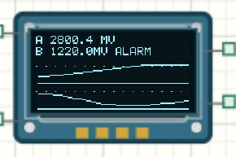

# SSD1306 OLED 文字与曲线

## 从数字到可读画面

SSD1306 控制 128×64 单色像素。本教程使用 [Learning05_Logger 完整工程](../projects/Learning05_Logger.alice.json)，与双路 ADC、滤波、CSV和报警共享同一项目，并非纯 OLED例程。先学会清缓冲、绘制、更新，再观察历史曲线。



## 打开并观察

打开工程包，构建运行，开关默认闭合。顶部显示两路带一位小数的 mV，下方各有一幅历史线，最新数据在右边。完整工程预置 8秒循环电压包络，曲线会随真实输入改变；源码文件夹默认使用静态 1.1 / 2.2 V。

手动测试时先在仿真设置中切换无限模式、停止包络覆盖，再编辑模拟源。断开开关，屏幕应显示 READY；重新闭合后，从新的采集会话建立曲线。

## 接线与 CubeMX

| 连接 | 本工程配置 |
| --- | --- |
| OLED SCL → PB6 | I²C1_SCL，复用开漏 |
| OLED SDA → PB7 | I²C1_SDA，复用开漏 |
| 电源 | 3.3 V，共地 |
| 上拉 | SCL、SDA 各 4.7 kΩ 到 3.3 V |
| I²C1 | 400 kHz，7 位地址模式 |
| 系统时钟 | HSE 8 MHz，PLL ×9，72 MHz |

本驱动初始化接受 7位地址 `0x3C`，内部再左移一位传给 HAL，不能提前传入 `0x78`。直接调用 HAL I²C函数时，要另按 HAL接口约定填写地址，别混用两层接口。

## 三步绘图

[main.c](../examples/Learning05_Logger/Core/Src/main.c) 在外设初始化后绑定设备。

```c
oled_status = AliceSIM_SSD1306_Init(
    &oled, &hi2c1, 0x3CU, 100U);
if (oled_status != HAL_OK) Error_Handler();
```

以下是工程 READY画面的绘制方式。坐标原点在左上，x向右、y向下；scale=2将字符放大。

```c
AliceSIM_SSD1306_Clear(&oled);
AliceSIM_SSD1306_DrawString(&oled, 34U, 14U,
    "READY", 2U, ALICESIM_SSD1306_COLOR_WHITE);
oled_status = AliceSIM_SSD1306_Update(&oled);
if (oled_status != HAL_OK) Error_Handler();
```

Clear和绘图修改的是 1024字节帧缓冲，Update才将画面送往屏幕。每次清空后必须把本帧需要保留的内容重画，避免旧数字留下残影，也避免只画了新数值却擦掉标题。

曲线使用两组各 32点历史数组，4像素为水平间距，将 0～3300 mV映射到各自区域。它与 32点采样滤波是两个缓存，前者标称每 100 ms增加一个显示点。阻塞 I²C刷新会耗时，不能把界面刷新周期当成精确硬件采样周期。

## 测试、排错和练习

静态输入 1.1 / 2.2 V稳定后，应接近 1100.0 / 2200.0 mV。把 A改为 3.1 V，A曲线渐升，B仍对应自己的输入；断开开关后两幅图被 READY替换。

空白先查供电、共地、上拉、PB6/PB7与地址；有旧画面却不更新，查 Update和返回状态。数字变、折线不动时还要考虑像素分辨率，小变化未必够移动一个像素。

练习把 READY改到左上角；为标题画一条横线；将刷新周期改为 200 ms并预测 32点历史跨度。每次先改一个参数，再用屏显和 USART2 CSV互相核对。
