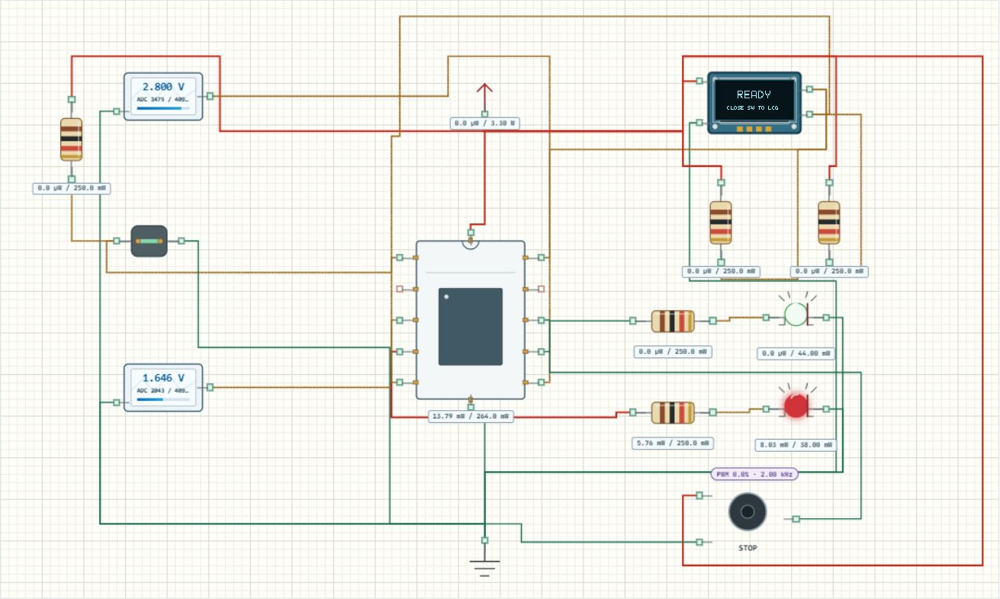

# 自主练习与创新

## 实验效果

把已有模块做成自己的测量终端：输入、程序、显示和记录都能说明同一件事。可以从 [双路记录仪工程](../projects/Learning05_Logger.alice.json) 开始，也可组合前面学过的舵机、数码管、点阵和继电器。每次只增加一项需求，再用输入证明它工作。



## 如何使用

1. 打开工程后，先运行原版，记录一组输入、屏幕和串口结果，再保存自己的完整项目副本。
2. 在程序页阅读 [记录仪 main.c](../examples/Learning05_Logger/Core/Src/main.c)，先写清要改变什么、预期怎样，再修改与构建。
3. 手动测试时切到无限运行；需要复位就先复位，再设置模拟源，避免包络首点覆盖设置。
4. 改完至少测试零输入、满量程、两路不同、仅 B 路越限、待机和重新开始。每项都保留预期与实际结果。

## 工程配置

| 组合前先检查 | 需要决定的事 |
| --- | --- |
| 引脚与定时器 | 舵机和记录仪蜂鸣器都占 PA8/TIM1_CH1，必须重新分配 |
| 电源与信号 | 舵机独立 5 V，MCU 3.3 V，共地并核对接口电平 |
| 数据单位 | raw、mV、0.1 mV 不能混用 |
| 任务节奏 | 采样、显示、通信各按什么条件执行 |
| 出错处理 | 无效数据怎样标记，恢复后是否清空历史 |

## 关键代码解释

记录仪通过下面的常量分别安排滤波与历史显示，两种缓存不能混为一谈。

```c
#define FILTER_SIZE       32U
#define HISTORY_SIZE      32U
#define SAMPLE_MS         20U
#define DISPLAY_MS       100U
```

保持 32 个历史点，改为标称每 200 ms 记一个点，首末跨度是 31×200 ms=6.2 秒。若阻塞通信改变实际间隔，应使用时间戳，或明确横轴只是等间隔索引。仿真用于检查程序与设备联动，不提供真实 MCU 指令周期或机械负载测量。

## 预期输入输出

先完成一段“低电压→高电压→低电压”，要求能从记录解释上升、报警、回差保持和解除，再断开开关验证 READY。只看截图中有数字不能算通过，必须核对两路单位与状态。

| 测试 | 留下什么证据 |
| --- | --- |
| 0 V、3.3 V | 手算换算值与显示 |
| 只改变 B 路 | A 保持，B 与对应曲线变化 |
| 越限后回到回差区 | 报警继续，低于解除线才停止 |
| OFF 后重新 ON | 新会话的滤波与历史按约定处理 |

## 故障排查

**断开输入没有超时**：某些模型会得到默认电压，0 V 也是有效测量。测试错误分支应选择确实返回失败的条件，或在测试副本注入失败并如实记录。

**想导出 CSV 却找不到按钮**：当前需暂停、复制串口，去掉界面时间与 UART 前缀，保留表头和数据后另存 UTF-8 CSV。虚拟串口只选 USART2，帧格式来自工程；蜂鸣器不会合成电脑音频。

## 练习与加分思路

以下只是起点，欢迎提出更多适合数据的表现方法。评价看是否清楚、可靠、可解释，不按元件数量评分。

| 方向 | 可以尝试 |
| --- | --- |
| 不同显示 | 柱状条、点阵热度、舵机指针、数码管轮显 |
| 更长记录 | 时间电压折线、分段保存、历史缩略图 |
| 更有用统计 | 峰值、谷值、平均值、超限累计时长 |
| 更稳报警 | 回差、延时确认、故障专用图案、分级提示 |
| 更好组织 | tick 调度、DMA 快照、明确缓冲区所有权 |

选一项写出设计，再提供输入、预期、实际、证据四列测试表。解释你舍弃了什么信息、什么时候清零，以及哪部分还需实物验证。
