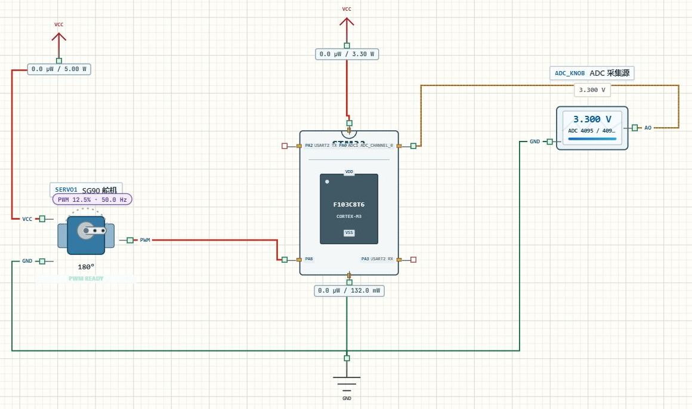

# PWM 控制舵机

## 实验效果

把电压从 0 V 调到 3.3 V，SG90 摇臂从 0°转到 180°，串口报告目标角度和高电平脉宽。本页与 ADC 教程共享 `Learning02_Servo`：ADC 决定目标，TIM1 持续产生控制脉冲。



[下载完整工程](../projects/Learning02_Servo.alice.json) · [阅读 main.c](../examples/Learning02_Servo/Core/Src/main.c)

## 如何使用

1. 在 AliceSIM 打开完整工程，构建、运行。
2. 电路页双击 `ADC_KNOB`，在属性中设置 0 V、1.650 V、3.3 V，逐次应用并观察摇臂。
3. 展开虚拟串口，选择 USART2，确认 115200 baud、8N1，记录 `PULSE` 数值。
4. 在逻辑分析仪添加 PA8，调整时间轴观察周期和高电平宽度。输入改变后，周期应保持约 20 ms。

## 工程配置

| 对象 | CubeMX 设置或接线 |
| --- | --- |
| TIM1 CH1 | PA8，PWM Generation CH1，Mode 1，高有效 |
| 计数器 | Prescaler=71，Period=19999，初始 Pulse=1500 |
| 时钟 | HSE 8 MHz、PLL ×9，TIM1 输入时钟 72 MHz |
| SG90 | PWM 接 PA8，VCC 接独立 5 V，GND 与 MCU 共地 |
| ADC | ADC1_IN0 接 PA0，0～3.3 V提供目标 |

两路电源正端不可相连。PA8 提供控制信号，不提供舵机工作电流。真实舵机的电流、接口阈值与机械端点需要按手中型号确认。

源代码里的 `htim1` 绑定 TIM1，`TIM_CHANNEL_1` 指向第一通道，二者要与 PA8 的复用设置一致。更换通道时同时核对句柄、引脚和启动调用。不同定时器的输入时钟未必相同，改时钟树后应重新计算，不能只根据 CPU 主频照填参数。

## 关键代码解释

初始化完成后先启动通道。只配置定时器、不启动 PWM，不会得到持续脉冲。

```c
if (HAL_TIM_PWM_Start(&htim1, TIM_CHANNEL_1) != HAL_OK)
  Error_Handler();
```

实际预分频除数是寄存器值加一，所以 72 MHz÷72=1 MHz，即一个计数为 1 μs。周期计数从 0 到 19999，共 20000 次，得到 20 ms、50 Hz。

```c
pulse_us = 500U + (adc_raw * 2000U + 2047U) / 4095U;
__HAL_TIM_SET_COMPARE(&htim1, TIM_CHANNEL_1, pulse_us);
```

第一行把 ADC 编码映射为 500～2500 μs。第二行更新比较值，改变每周期的高电平宽度，ARR 保持不动，因此频率没有变化。末尾的 U 表示无符号整数，不是微秒单位；本例恰好按 1 μs 计数，所以数值相同。

占空比是高电平宽度除以周期。这里从 2.5% 变到 12.5%，但控制含义是目标角度，不能理解为“占空比越大转速越快”。模型展示目标映射，不包括负载、惯性和电流的完整机械过程。

## 预期输入输出

| 输入电压 | 高电平 | 周期 | 模型角度 |
| --- | --- | --- | --- |
| 0 V | 500 μs | 20 ms | 0° |
| 约 1.65 V | 约 1500 μs | 20 ms | 约 90° |
| 3.3 V | 2500 μs | 20 ms | 180° |

500～2500 μs 是本平台 SG90 默认范围，实物不一定允许这个全范围。

## 故障排查

**串口变化，舵机不动**：核对 PA8 控制线、5 V供电、共地与 PWM 启动调用。

**周期和预期差一大截**：重算实际 TIM1 时钟与两个“加一”。不要把其他工程的分频参数直接抄进来。

## 练习

1. 将控制范围限制为 30～150°，先算脉宽端点，再同步修改显示映射。
2. 给输入添加三角包络，比较斜坡与阶跃产生的目标变化。
3. 每轮只让输出脉宽向目标靠近固定步长，做软件缓变；说明它与降低 PWM 频率的区别。
