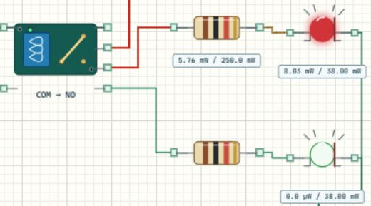

# 继电器触点与负载回路

## 控制信号不等于负载电源

继电器让 MCU用一个控制信号切换另一条电流路径。本文使用 [Learning06_Components 完整工程](../projects/Learning06_Components.alice.json)，与超声波、点阵、蜂鸣器共享泊车提示台，并非独立继电器例程。红绿灯由实际 COM/NO/NC连通关系决定。



## 打开并观察触点

打开完整工程，构建运行。将 HC-SR04目标距离设为 150 cm，继电器释放，绿灯亮、红灯灭；改为 25 cm后继电器吸合，红灯亮、绿灯灭。恢复 150 cm应恢复绿灯。USART2设置为 115200、8N1，可核对 `RELAY=OFF` 和 `RELAY=ON`。

## 两侧分别接线

| 部分 | 本工程连接 |
| --- | --- |
| 模块 VCC / GND | 5 V / 公共地 |
| 模块 IN | PB12，低电平有效 |
| COM | 独立 3.3 V负载电源正端 |
| NC | 经 330 Ω、绿 LED回到负载地 |
| NO | 经 330 Ω、红 LED回到负载地 |
| CubeMX | PB12推挽输出，初始高，HSI 8 MHz |

NC是常闭，NO是常开，“常”指线圈未吸合时。释放时 COM连 NC，吸合时 COM连 NO。模块 VCC给线圈与驱动供电，COM给灯的支路提供电源；二者即使都画成电源，也不是同一个端子。

本例是带驱动电路的继电器模块，不是 MCU直接驱动裸线圈。真实裸继电器通常还需要驱动器件和续流保护。实际模块的低有效电平、3.3 V兼容性及供电方式应按其手册核对，不能只凭外形照接。

## 程序怎样切换

[main.c](../examples/Learning06_Components/Core/Src/main.c) 先按距离得到区域，安全和注意区释放继电器，停止或故障区吸合。下面两句分别来自不同分支，不要把它们接连执行当成测试。

```c
/* 安全或注意区，低有效模块保持释放。 */
HAL_GPIO_WritePin(GPIOB, GPIO_PIN_12, GPIO_PIN_SET);
```

```c
/* 距离过近或测距故障，模块吸合。 */
HAL_GPIO_WritePin(GPIOB, GPIO_PIN_12, GPIO_PIN_RESET);
```

PB12只改变模块 IN，红绿灯能量来自 COM侧负载电源。本例没有用一个 GPIO直接反向驱动两只灯。沿“3.3 V→COM→闭合触点→电阻→LED→GND”画出完整路径，就能判断哪只灯应该亮。

## 明确测试与排错

依次输入 100.0、50.0、49.9 cm，预期继电器分别 OFF、OFF、ON，前两次绿亮，第三次红亮。停止并断开传感器电源后重新构建运行，应进入故障报警，继电器 ON。断线实验请另存副本。

继电器状态变化而灯都不亮，先查 COM电源、负载回路、LED方向；两灯总一起亮，查 NC/NO是否短接。结果与程序相反，先核对模块是否低有效，再判断是否把 NC和 NO接反，不要同时改代码与接线。

## 练习

将红绿支路交换并预测现象；在安全状态断开一条负载线，区分控制成功和负载失效；另用独立 GPIO增加故障灯，使“过近”和“测距失败”可区分。本练习只使用低压 LED，无需连接市电负载。
