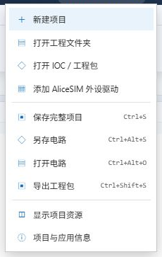
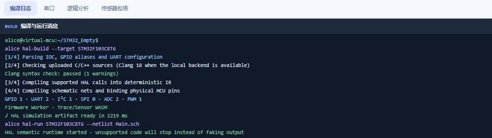

# 下载、启动与打开工程

## 准备软件

若你正在随项目提供的 AliceSIM 中阅读本页，教程和十四套工程已经在本地，无需再下载一份。平台更新见 [AliceSIM 项目页](https://github.com/new-bmp/AliceSim)。教程使用同目录的平台版本；旧版软件可能尚未包含某些模块支持。

Windows 源码方式需要 64 位 Python 3.10 或更新版本，可从 [Python 官网](https://www.python.org/downloads/windows/) 安装，并启用加入 PATH 的选项。配置引脚与生成 HAL 工程使用 [STM32CubeMX](https://www.st.com/en/development-tools/stm32cubemx.html)。已打包的桌面版本按该版本的说明安装，不需要把源码 ZIP 当安装程序运行。

## 从源码启动

1. 将 AliceSIM 完整源码解压到自己有写入权限的目录，不能在压缩文件预览里运行。
2. 双击根目录的 `AliceSIM.cmd`，保留服务窗口。
3. 首次启动会准备构建依赖，需要网络。等待服务就绪，使用启动器实际显示的地址；端口可能随占用情况改变。
4. 默认尝试以无边框全屏窗口打开。需要普通窗口时，在项目目录的 PowerShell 中使用以下命令。

```powershell
.\AliceSIM.cmd -Windowed
```

关闭页面不一定停止后端。结束使用时可在服务窗口按 Ctrl+C；下次从启动器进入，避免访问已经失效的端口。移动端可以阅读教程，固件构建能力以当前版本和后端连接为准。

## 打开第一套工程

进入 [第一个闪灯程序](mcu-first.md)，下载顶部“完整工程 · JSON”。回到工作台，在“项目 → 打开 IOC / 工程包”选择 `Learning07_Blink.alice.json`。它包含程序、IOC、电路与工作区设置。已有基础也可以选择 [GPIO 开关与状态灯](gpio.md)。



另一种方法是导入 `tutorials/examples/Learning07_Blink` 整个文件夹。应选同时含 `.ioc`、`Core` 和 `Drivers` 的目录。若没有带出电路，再用“打开电路”选择目录内的 `.alice-sch.json`。只导入 IOC 无法代替完整程序。

| 文件或目录 | 用途 |
| --- | --- |
| `.ioc` | 芯片、引脚、时钟及外设配置 |
| `Core/Inc`、`Core/Src` | 声明、初始化、中断及实验逻辑 |
| `Drivers` | HAL、CMSIS 与模块驱动，保留许可证 |
| `.alice-sch.json` | 独立接线电路，不含全部程序 |
| `.alice.json` | 可重新打开的完整 AliceSIM 项目 |

## 构建成功后再运行

电路页点击“构建”，等待完整构建成功再点击“运行”。仅有 Clang 语法检查通过还不够，后面还有 HAL 建模和引脚绑定。Learning07 的绿灯应每 500 ms 翻转一次。若选择 Learning01，初始应红灯亮、绿灯灭；双击开关切换后两灯反转。



Learning07 只有闪灯，没有启用串口。后续串口例程中，展开串口并选择 USART2，确认显示 115200 baud 与 8N1。参数来自工程配置，不需要在虚拟串口面板重新设置，也不需要授权实体串口。

## 打不开或构建失败

“Failed to fetch”先检查服务窗口是否仍在运行，以及页面是否使用该服务的地址。找不到 `adc.h`、`i2c.h` 时，检查导入的是否是完整工程根目录、头文件是否齐全。

有源码行号的报错要回到该行及其配置排查，不要靠删除初始化和错误处理绕过。看到传感器预览并不能证明固件构建成功。第一次实验完成后，继续阅读 [工作台操作与保存](workspace.md)，把可重新打开的工程保存下来。
