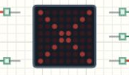

# SPI 与 MAX7219 点阵

## 发送的字节就是图案

MAX7219 把串行寄存器数据变成 8×8像素。本文与测距、蜂鸣器、继电器教程共用 [Learning06_Components 完整工程](../projects/Learning06_Components.alice.json)，并非独立点阵项目。三种图案由程序按距离选择，实际通过 SPI和片选送出。



## 打开与观察

打开工程，构建运行。将 HC-SR04目标距离设为 150、75、25 cm，点阵应依次为笑脸、感叹号、大 X。模块是单色红点阵，区域不会把像素变绿，外部红绿灯表达另一组状态。

## 接线和 CubeMX

| 模块引脚 | MCU与配置 |
| --- | --- |
| CLK | PA5，SPI1_SCK |
| DIN | PA7，SPI1_MOSI |
| CS | PB0，GPIO推挽输出，初始高 |
| SPI1 | 主机，8位，MSB first，Mode 0，Software NSS |
| 时钟分频 | HSI 8 MHz，SPI分频 16，约 500 kbit/s |
| 电源 | 模块 5 V，与 MCU共地 |

真实 5 V MAX7219的输入高阈值可能高于 3.3 V，实物应给 CLK、DIN、CS配置合适的单向电平转换，例如满足条件的 74AHCT器件。仿真验证逻辑与协议，不能用“屏亮了”证明实物电平裕量足够。

## 一个寄存器一帧

[main.c](../examples/Learning06_Components/Core/Src/main.c) 中的 `Matrix_WriteRegister` 是普通 C函数，发送地址与数据两个字节，再拉高 CS锁存。

```c
uint8_t packet[2];
packet[0] = address;
packet[1] = value;
HAL_GPIO_WritePin(GPIOB, GPIO_PIN_0, GPIO_PIN_RESET);
if (HAL_SPI_Transmit(&hspi1, packet, 2U, 100U) != HAL_OK)
  Error_Handler();
HAL_GPIO_WritePin(GPIOB, GPIO_PIN_0, GPIO_PIN_SET);
```

初始化写 0x0F=0关闭测试，0x09=0关闭 BCD译码，0x0B=7扫描八行，0x0A=8设置亮度，0x0C=1进入正常显示。原始点阵模式下，寄存器 1～8对应八行，一字节的八位对应八个像素。

```c
for (row = 0U; row < 8U; row++)
  Matrix_WriteRegister(row + 1U, picture[row]);
```

大 X前两行分别为 0x81和 0x42，即 10000001与 01000010，亮点逐行向中间收拢。工程只在区域改变时重画，距离在同一区域内小幅变化时，不重复发送同一图案。

本模块由 MCU单向写入，不依赖 MISO返回像素。PB0是普通 GPIO片选，不是让硬件自动管理 NSS；因此发送函数返回不等于锁存已经完成。要看见本帧，还需要代码执行最后的 CS拉高。

## 明确测试和排错

150 cm应显示完整笑脸；75 cm应看到中间竖线和下方点；49.9 cm应显示 X，50.0 cm则回到感叹号。可同时看 USART2的 ZONE字段，区分“区域判断错”和“像素传输错”。

SPI返回成功但屏不变，检查 CS是否接对及每帧结束是否拉高，再查 CLK、DIN和供电。图案数字化却不成形，检查是否关闭 BCD译码；镜像或转向不符则核对模块行列、位序，别把它误当距离计算错误。

## 练习

在方格纸设计箭头并写出八个十六进制字节；更改亮度寄存器并比较；增加独立故障图案，使传感器故障不再与距离过近共用 X。每次保留原图案，便于排除修改造成的问题。
