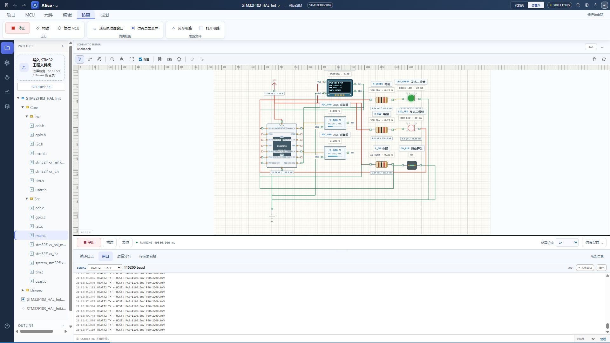

# 从这里开始

这里按知识点学习 STM32 外设。每篇先给出实验效果和打开方法，再解释 CubeMX 配置、接线、关键代码与排错。完整代码保留在例程里，正文只取需要理解的片段。

## 先跑通，再修改

1. 阅读 [下载、启动与打开工程](setup.md)，准备 AliceSIM 本地环境。
2. 零基础先读 [电路与电平](electrical.md)，再打开 [第一个闪灯程序](mcu-first.md)，只观察一只灯。
3. 读 [CubeMX 配置](cubemx.md) 和 [C 与 HAL](c-hal.md)，再用 [数组与指针流水灯](c-data.md) 练习数据组织。
4. 每次只改一个条件，重新构建，写下预期并与实际结果比较。

## 教程与例程的关系

教程文件夹自带十四套 STM32F103C8T6 工程，物理目录是 `tutorials/examples`。每篇顶部可以下载直接打开的 `.alice.json`，也能下载包含源码、IOC、电路和工程包的 ZIP。31 篇教程按学习顺序排列，工程编号保留原有编号；入门请从 07 闪灯开始，不必按工程编号顺序学习。

## 按这条路线学习

| 阶段 | 阅读与操作 | 完成后应能解释 |
| --- | --- | --- |
| 电路与最小程序 | [电路](electrical.md) → [闪灯](mcu-first.md) → [CubeMX](cubemx.md) | 共地、限流、初始化和循环分别做什么 |
| C 数据与 GPIO | [C/HAL](c-hal.md) → [数据与指针](c-data.md) → [GPIO](gpio.md) | 数组下标、指针写回、输入有效电平 |
| 时间与事件 | [tick 与状态机](tick-state.md) → [消抖](button-debounce.md) → [EXTI](exti.md) → [定时器](timer-irq.md) | 等待期间如何响应输入，中断与主循环如何分工 |
| 测量与通信 | [ADC](adc.md) → [PWM](pwm-servo.md) → [UART 输出](uart.md) → [UART 接收](uart-rx.md) | 原始码、物理量、波形与命令边界 |
| 总线与模块 | [I²C](i2c-basics.md) → [SPI](spi-basics.md)，再选择传感器和显示模块 | 如何从数据手册找到地址、寄存器和时序 |
| 排错与迁移 | [排错实验](debugging.md) → [真实开发板](hardware.md) | 如何证明问题位置，并完成下载、断点与单步 |
| 综合设计 | [DMA](dma.md) → [趋势记录](logger.md) → [自主练习](practice.md) | 数据搬运、处理、显示、报警怎样组织 |

已有基础可以直接跳到对应课程。每次只加一项功能，保留前一阶段可运行的版本。

## 完整工程索引

| 完整工程 | 配合学习的模块 |
| --- | --- |
| Learning01_GPIO | 开关、独立红绿灯、串口状态输出 |
| Learning02_Servo | ADC 单次采样、PWM、舵机 |
| Learning03_Climate | DHT11、TM1637、定点数显示 |
| Learning04_DMA | ADC 循环 DMA、半完成与完成回调 |
| Learning05_Logger | 双路采集、均值滤波、OLED 趋势、回差报警、CSV |
| Learning06_Components | 超声波、SPI 点阵、PWM 蜂鸣器、继电器负载 |
| Learning07_Blink | 电路基础、最小闪灯、排错与实机迁移 |
| Learning08_CData | 数组、指针、结构体、位操作与流水灯 |
| Learning09_TickTasks | 两路独立闪烁、开关与状态机 |
| Learning10_ButtonEXTI | 消抖、单次计数、长按与外部中断 |
| Learning11_TimerIRQ | 定时器更新中断与主循环分工 |
| Learning12_UARTCommand | 分段接收、换行组帧、命令与长度边界 |
| Learning13_I2CBasics | I²C 地址、命令与 OLED 基础显示 |
| Learning14_SPIBasics | SPI 片选、寄存器与点阵像素 |

多篇教程可以共用一个完整工程。例如 ADC 和舵机放在同一工程里：先观察输入原始码，再研究它如何换算为脉宽。模块页会说明共享关系，不必为了阅读下一篇重复导入工程。

## 每次实验留下什么

保留修改过的代码、输入条件、预期输出和一份运行证据。串口用于核对数值和分支，屏幕与负载用于核对最终效果，逻辑分析用于观察数字信号。结果不同时，先判断是输入、计算、配置还是接线出了问题。

从固定输入开始，再做缓慢变化，最后测试阈值附近、断开和超时。完成基础操作后可进入 [自主练习与创新](practice.md)，为同一个数据设计不同展示方式。

## 认识仿真边界

AliceSIM 根据 HAL 行为、引脚网络与设备模型执行程序，适合练习配置、控制流程、驱动和输出响应。仿真 tick、界面帧率不能直接代表真实 STM32 的指令周期或性能。噪声、供电裕量、机械负载与干扰仍需实物验证。

例如本版蜂鸣器有工作状态和 PWM 可视效果，但不会通过电脑扬声器合成音调。模块页会注明这类限制。遇到固件错误要查看构建和运行日志；传感器包络预览不是固件已成功运行的证据。
