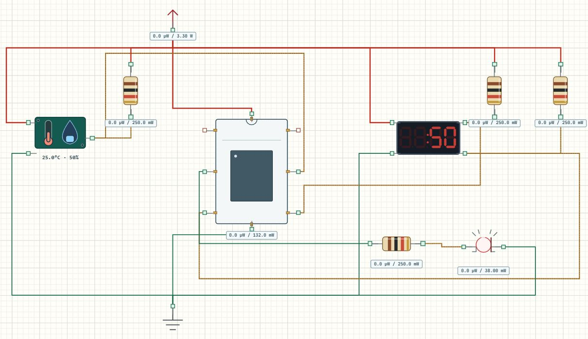

# TM1637 四位数码管

## 显示什么由程序决定

TM1637 接收数字或段码，负责驱动四位数码管。本文与 DHT11 教程共用 [Learning03_Climate 完整工程](../projects/Learning03_Climate.alice.json)，并不是只有显示模块的独立项目。这里用温湿度作为数据，重点学习显示参数和含义约定。



## 打开运行

打开完整工程，构建并运行，仿真约 1.1 秒后应先显示 25，一秒后显示 50，再循环。冒号灭表示温度，冒号亮表示相对湿度，这是本程序的约定，数码管自身并不知道单位。

在虚拟串口选择 USART2，核对 115200、8N1，可以看到明确的 TEMP、HUM标签和单位。将 DHT11 属性改为 31 °C、72 %RH，等待新一轮后，数码管应交替显示 31、72，串口同步改变。

## 接线与 CubeMX

| 引脚 | 本工程配置 |
| --- | --- |
| CLK → PB6 | GPIO Output Open Drain，高电平，上拉 |
| DIO → PB7 | GPIO Output Open Drain，高电平，上拉 |
| VCC / GND | 3.3 V / 公共地 |
| 外部电阻 | CLK、DIO 各 4.7 kΩ 上拉到 3.3 V |
| 系统时钟 | HSI 8 MHz |

这两根线使用 TM1637 的时序，由 GPIO驱动，不能因为“也是两根线”就在 CubeMX中配置成 I²C。开漏输出主动拉低，释放时由上拉拉高，DIO还用于返回应答。

## 参数怎么用

[main.c](../examples/Learning03_Climate/Core/Src/main.c) 先绑定引脚，再设置亮度和启用状态。

```c
AliceSIM_TM1637_Init(&digits, GPIOB, GPIO_PIN_6,
                    GPIOB, GPIO_PIN_7, Timing_DelayUs);
AliceSIM_TM1637_SetBrightness(&digits, 5, 1);
```

亮度参数范围为 0～7；最后的 1表示启用显示。亮度 0仍是最低亮度，想关闭应将启用参数设为 0，二者不要混淆。

```c
AliceSIM_TM1637_DisplayNumber(&digits,
    climate_sample.temperature_x10 / 10, 0, 0);
HAL_Delay(1000);
AliceSIM_TM1637_DisplayNumber(&digits,
    climate_sample.humidity_x10 / 10, 0, 1);
```

`DisplayNumber` 最后两个参数依次控制前导零和冒号。此处都不补前导零，温度关冒号、湿度开冒号。除以 10使数码管显示整数；小数并未从采样结构体消失，串口仍保留一位。两次显示来自同一次读取，第二次没有重新采样。

## 明确测试与排错

保持环境 25 / 50，检查数字与冒号顺序。将亮度从 5改为 1、再改 7，重建后比较；最后只把启用参数改为 0，应整体关闭。传感器故障时，工程调用 `AliceSIM_TM1637_Clear` 清空显示，避免旧数字伪装成新读数。

串口正常但屏空白，先查 VCC、共地、CLK/DIO是否互换，再查开漏、上拉和启用参数。数字正确但含义不明，应改图例或文字提示，不能要求观看者自己猜温湿度。

## 练习

改成补前导零，比较 25和 0025；让每种数据显示两秒，计算采样间隔随之怎样变化；用 `DisplayRaw` 设计“----”等状态图案，先核对驱动段码定义，再使用四字节数组。保留串口标签，验证数码管状态与真实数据一致。
