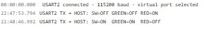

# UART 输出状态和测量记录

## 实验效果

先让开关切换产生一条状态记录，再观察双路记录仪输出的 CSV。串口适合核对代码分支、单位和时间，也能发现“灯没亮”究竟是输入判断还是输出接线出了问题。



起点是 [GPIO 完整工程](../projects/Learning01_GPIO.alice.json) 和 [GPIO main.c](../examples/Learning01_GPIO/Core/Src/main.c)。进阶使用 [记录仪工程](../projects/Learning05_Logger.alice.json)，实现见 [记录仪 main.c](../examples/Learning05_Logger/Core/Src/main.c)。

## 如何使用

1. 在 AliceSIM 打开 GPIO 工程，构建后运行。
2. 展开底部“串口”，只需选择 USART2，确认旁边显示 115200 baud、8N1。波特率与帧格式来自工程，面板没有另一套设置。
3. 双击电路开关切换 OFF、ON。每次改变增加一行，保持不动不会刷出重复状态。
4. 打开记录仪工程后重新构建。运行时可见表头和周期数据；断开开关出现 READY。蜂鸣器只显示 PWM 工作状态，当前不会让电脑扬声器播放音调。

## 工程配置

| 项目 | 两个工程的配置 |
| --- | --- |
| USART2 | Asynchronous，PA2 TX、PA3 RX |
| 帧格式 | 115200，8 位数据，无校验，1 位停止位 |
| 观察入口 | AliceSIM 虚拟串口，直接接收固件发送事件 |
| 实体扩展 | 真板应将 TX 接适配器 RX，并核对共地与接口电平 |

学习虚拟串口不必额外添加串口器件，也不必点击“实体串口”授权电脑端口。实体串口按钮用于另一项双向桥接功能。

## 关键代码解释

GPIO 工程提前准备文本数组，发送时指定有效字节数。

```c
uint8_t report_on[] = "SW=ON  GREEN=ON  RED=OFF\r\n";
HAL_UART_Transmit(&huart2, report_on,
  sizeof(report_on) - 1U, 100U);
```

`&huart2` 选择外设，数组是数据来源，长度减一避免发送字符串末尾的空字符，100U 为超时毫秒数。`\r\n` 是回车换行。它是阻塞发送，长文本会占用主循环时间。

记录仪通过 `snprintf` 生成文本，再检查返回长度后发送。拆分小数使用整数除十和余十，例如 `mv10_a=11000` 显示为 1100.0 mV。其表头如下，列顺序不能随意打乱。

```c
uint8_t csv_header[] = "tick_ms,a_mV,b_mV,alarm,state\r\n";
```

CSV 的 tick 单位为毫秒，电压列已经是 mV。RUN、ALARM 是有效采集状态，READY、ADC_ERROR 应作为状态标记处理，不能把旧值直接接进正常曲线。

## 预期输入输出

| 操作 | 应出现的内容 |
| --- | --- |
| GPIO 开关切到 ON | SW=ON，GREEN=ON，RED=OFF |
| 保持 ON | 不重复发送相同状态 |
| 记录仪运行 | 表头后持续出现时间、电压、报警与状态 |
| 记录仪开关断开 | 一条 READY，停止周期采集输出 |

## 故障排查

**没有输出**：确认构建成功、正在运行、选择正确 USART，并看编译与运行日志。切换端口不会重新发送已经错过的启动表头。

**文本截断或乱码**：检查发送长度与缓冲容量、格式符与参数类型，不要把 `snprintf` 所需长度无条件当作实际有效长度。

## 练习

1. 修改状态描述，保留正确长度计算，重新构建验证。
2. 给 GPIO 状态增加 `HAL_GetTick()` 时间戳。
3. 暂停记录仪，复制串口文本到编辑器，去掉界面时间和 `USART2 TX → HOST:` 前缀，保留 CSV 表头与数据，存成 UTF-8 `.csv` 后按逗号导入表格绘图。当前没有 CSV 下载按钮。
