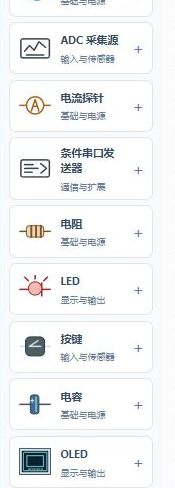
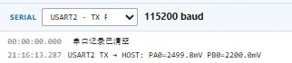
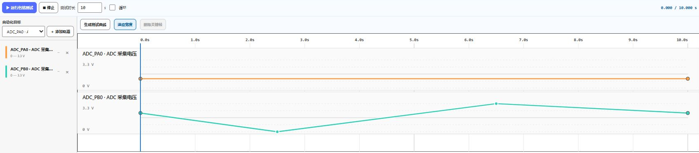

# 工作台操作与保存

## 从信号出发阅读电路

工作区用于阅读工程树、源码和 IOC，电路页用于接线与运行观察。先从输入元件的信号端找到 MCU 引脚，再找到程序控制的输出脚和负载，最后检查电源与公共地。

元件靠近、导线视觉交叉都不等于已连接。检查线端是否落在端子上；有疑问时放大对应区域。

## 添加元件和连接导线

打开元件库，按型号或类别查找，添加后调整位置。选中元件可查看属性，修改电压、距离等输入。名称用于辨认，实际行为取决于元件类型、端子与连接。

鼠标模式下双击端子可开始导线；导线模式中点击起点与终点，右键取消当前布线。移动视野可用平移工具，适用设备上也能右键拖动画布。触屏设备优先使用可见工具按钮。浏览器自身的右键手势可能截获输入，遇到冲突可使用启动器窗口。

“标签”控制元件及引脚标签显示。观察屏幕时可隐藏，检查接线时重新打开。找不到元件时先“适应窗口”，再放大 OLED、点阵或触点。

## 按需展开运行工具

编译日志、串口、逻辑分析与传感器包络可以折叠。先把电路和当前数据留在视野里，再展开需要的工具。虚拟串口直接展示固件发送事件，选择正确 USART 即可。

逻辑分析适合观察数字引脚电平、周期和边沿。传感器包络用于给输入设置随时间变化的测试条件。它会覆盖手动输入；需要固定电压时，先停止包络覆盖，再修改模拟源。重置可能把输入写回首节点值，因此按“重置、再手动赋值”的顺序测试。

## 保存完整项目

“保存完整项目”或 Ctrl+S 保存源码、IOC、电路及工作区设置。通过可写文件夹导入时，平台在所选工程根目录创建 `AliceSIM` 文件夹，保存完整项目和工作源码副本。原 CubeMX 工程与 AliceSIM 工作副本要分清，重新生成 CubeMX 前也要备份。

没有可写目录时，Ctrl+S 存入浏览器本地存储。恢复要求同一浏览器、同一页面地址；换端口、浏览器，或在 localhost 与 127.0.0.1 之间切换，都可能进入另一份存储。交作业或迁移电脑时，请导出文件。

| 操作 | 快捷键 | 适用范围 |
| --- | --- | --- |
| 保存完整项目 | Ctrl+S | 当前工作与本地恢复 |
| 导出完整工程 | Ctrl+Shift+S | 下载 `.alice.json`，用于备份和提交 |
| 另存电路 | Ctrl+Alt+S | 仅接线图，不代替完整项目 |
| 打开电路 | Ctrl+Alt+O | 加载独立电路 |
| 撤销 / 重做 | Ctrl+Z / Ctrl+Y | 编辑操作，留意当前编辑区域 |

每次确认保存提示，导出后检查文件实际位置。关闭再打开完整项目，核对代码、输入、元件位置与导线。保存项目不等于保存 MCU 寄存器、RAM 和程序计数器的硬件快照；重新运行会初始化固件。
